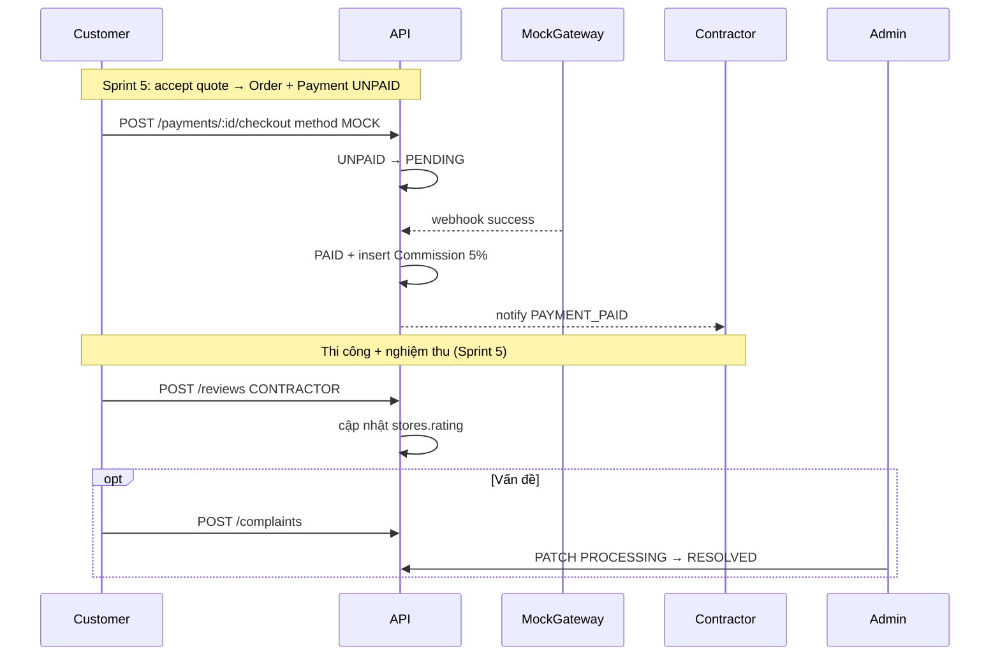

# Business flow — Sprint 6 (Architecture Lock)

Tài liệu này là **luồng nghiệp vụ** (tiếng Việt) khớp các file lock tiếng Anh. Không implement trong bước này.

Xem: [SPRINT6_ARCHITECTURE.md](./SPRINT6_ARCHITECTURE.md).

---

## 1. Happy path (có thanh toán đủ)



---

## 2. Money flow

```
Khách trả tiền
  → BuildMate (merchant)
  → 5% platformAmount (sổ commissions)
  → 95% contractorAmount (sổ, chưa chuyển ngân hàng)
```

Nhà thầu **không** nhận API rút tiền. Màn hình earnings chỉ là sổ cái.

---

## 3. State machines (tóm tắt)

**Payment:** `UNPAID → PENDING → PAID | FAILED`; `PAID → REFUNDED`; `FAILED → PENDING` (thử lại).

**Commission:** `POSTED` (khi PAID) → `REVERSED` (khi refund).

**Review:** insert một lần sau `CUSTOMER_ACCEPTED`. Mục tiêu: `CONTRACTOR` hoặc `MATERIAL_STORE`.

**Complaint:** `OPEN → PROCESSING → RESOLVED | REJECTED`.

**Order:** `QUOTATION_ACCEPTED` → `DEPOSIT_PAID` → `STARTED` → `IN_PROGRESS` → `COMPLETED` → `CUSTOMER_ACCEPTED`. Thanh toán không bắt buộc để nhà thầu hoàn thành việc. Cọc đưa đơn tới `DEPOSIT_PAID`.

---

## 4. Split cọc / tất toán (tùy chọn)

Mặc định demo: **một** `FULL_PAYMENT` = `order.amount`.

Nếu bật split:

1. Dòng Sprint 5 đổi type `DEPOSIT` (30%) + thêm `FINAL_PAYMENT` (70%).
2. Cọc: thanh toán từ `QUOTATION_ACCEPTED`.
3. Tất toán: khi `COMPLETED` hoặc `CUSTOMER_ACCEPTED`.
4. Mỗi lần PAID tạo **một** commission trên số tiền giao dịch đó.

---

## 5. Admin analytics

Một `GET /admin/analytics` (cache 60s):

| Khối | Nguồn |
| --- | --- |
| Users / roles | `users` count |
| Orders | `orders` count by status |
| Revenue | `payments` PAID sum |
| Commission / earning | `commissions` POSTED sums |
| Top contractors | `stores.rating` + completed orders |
| Top services | `repairrequests.category` join orders COMPLETED |

Không tạo collection thống kê riêng.

---

## 6. Demo script (khi code 6.2)

1. Customer chấp nhận báo giá (đã có từ Sprint 5) → Pay now (Mock) → toast PAID.
2. Contractor xem earnings (95%).
3. Contractor hoàn thành tiến độ → Customer nghiệm thu → 5 sao contractor.
4. (Tùy chọn) Complaint DELAY → Admin PROCESSING → RESOLVED.
5. Admin dashboard: users, orders, revenue.

Tài khoản seed giữ nguyên (`Demo@1234`).

---

## 7. Không làm trong Sprint 6

- Cổng thanh toán thật (MoMo/Stripe live)
- Chi hộ / đối soát ngân hàng
- Contractor review khách
- Sửa/xóa review
- App React Native
- Thuế / hóa đơn điện tử
