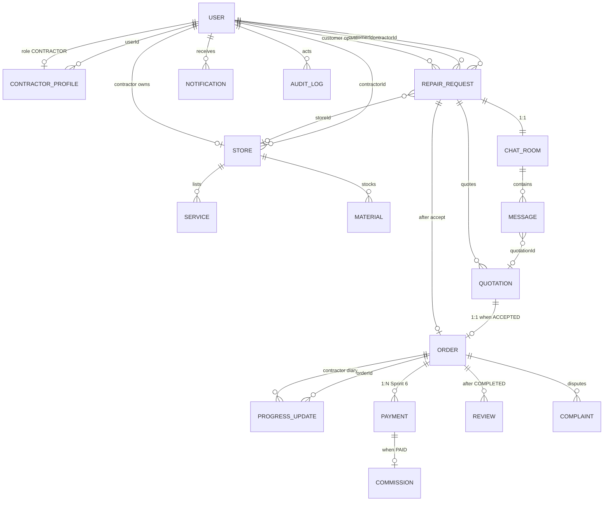

# Database — final lock (Sprint 1–6 schema)

Database name: `buildmate`.  
Collection names, fields, enums stay **English**.  
This document is the ERD of record for Sprint 1–5. **Sprint 6 payment 1:N, commissions, reviews, complaints** are locked in [SPRINT6_ARCHITECTURE.md](./SPRINT6_ARCHITECTURE.md) and supersede §6–8 below.

Related: [SPRINT5_ARCHITECTURE.md](./SPRINT5_ARCHITECTURE.md), [ORDER_DESIGN.md](./ORDER_DESIGN.md), [SPRINT6_ARCHITECTURE.md](./SPRINT6_ARCHITECTURE.md).

---

## 1. ERD



Mongo collection names:

| ERD box | collection | model |
| --- | --- | --- |
| USER | `users` | User |
| CONTRACTOR_PROFILE | `contractorprofiles` | ContractorProfile |
| STORE | `stores` | Store |
| SERVICE | `services` | Service |
| MATERIAL | `materials` | Material |
| REPAIR_REQUEST | `repairrequests` | RepairRequest |
| CHAT_ROOM | `chatrooms` | ChatRoom |
| MESSAGE | `messages` | Message |
| QUOTATION | `quotations` | Quotation |
| NOTIFICATION | `notifications` | Notification |
| AUDIT_LOG | `auditlogs` | AuditLog |
| ORDER | `orders` | Order |
| PROGRESS_UPDATE | `progressupdates` | ProgressUpdate |
| PAYMENT | `payments` | Payment |
| COMMISSION | `commissions` | Commission (Sprint 6) |
| COMMISSION_RULE | `commissionrules` | CommissionRule (Sprint 6) |
| REVIEW | `reviews` | Review |
| COMPLAINT | `complaints` | Complaint |

---

## 2. Frozen collections (as shipped Sprint 4.5)

All have `createdAt` / `updatedAt` via Mongoose timestamps unless noted.

### users

| Field | Type | Notes |
| --- | --- | --- |
| `_id` | ObjectId | |
| `name` | string 2–80 | |
| `email` | string unique | |
| `password` | string | hashed, `select: false` |
| `phone` | string | |
| `avatar` | string URL | |
| `role` | enum | `CUSTOMER` `CONTRACTOR` `MATERIAL_STORE_OWNER` `ADMIN` |
| `status` | enum | `ACTIVE` `INACTIVE` `PENDING_VERIFICATION` `BANNED` |
| `preferredLanguage` | enum | `vi` `en` optional |
| `location` | GeoJSON Point | `[lng,lat]`, 2dsphere |

Indexes: `email` unique, `location` 2dsphere, `{ role: 1, status: 1 }`.

### contractorprofiles

| Field | Type | Notes |
| --- | --- | --- |
| `userId` | ObjectId unique | → users |
| `businessName` `taxCode` `address` `city` `description` | string | |
| `yearsExperience` | number | |
| `serviceAreas` | string[] | |
| `verificationStatus` | enum | `DRAFT` `SUBMITTED` `APPROVED` `REJECTED` |
| `documents[]` | `{ type, url, originalName, mimeType, size }` | types: `BUSINESS_LICENSE` `CERTIFICATE` `ID_CARD` `STORE_IMAGE` `PORTFOLIO` |
| `rejectionReason` | string | |
| `submittedAt` `reviewedAt` `reviewedBy` | date / ObjectId | |

Index: `{ verificationStatus: 1, submittedAt: -1 }`.

### stores

| Field | Type | Notes |
| --- | --- | --- |
| `contractorId` | ObjectId unique | → users |
| `name` `slogan` `description` `phone` `address` `city` | string | |
| `storeType` | enum | `SERVICES` `MATERIALS` `BOTH` |
| `coverImage` `gallery[]` | string | |
| `openingHours` | string | |
| `serviceRadiusKm` | number 1–50 | |
| `category` | string | |
| `verified` | bool | set on admin approve |
| `rating` `reviewCount` | number | seed until Review aggregate (Sprint 6) |
| `status` | enum | `DRAFT` `LIVE` `PAUSED` |
| `location` | GeoJSON Point | **2dsphere** |

Indexes: `location` 2dsphere, `{ status: 1, storeType: 1 }`.

### services / materials

Unchanged. Both: `storeId`, `contractorId`, catalog fields, `isActive`.  
Indexes: `{ storeId: 1, isActive: 1 }`, `{ category: 1 }`.

Quotation **copies** name/price; `catalogId` on a line item is optional and must not be required at Order birth.

### repairrequests

| Field | Type | Notes |
| --- | --- | --- |
| `customerId` `contractorId` | ObjectId | |
| `storeId` | ObjectId? | |
| `category` | enum | `PLUMBING` `ELECTRIC` `PAINTING` `WATERPROOF` `TILE` |
| `title` `description` | string | |
| `images[]` `videos[]` | string URL | |
| `address` | string | |
| `location` | GeoJSON Point | 2dsphere |
| `status` | enum | `PENDING` `ACCEPTED` `REJECTED` `COMPLETED` + **additive `CANCELLED`** |

Indexes: `{ customerId: 1, createdAt: -1 }`, `{ contractorId: 1, createdAt: -1 }`, `location` 2dsphere.

### chatrooms / messages / quotations

Unchanged. ChatRoom `requestId` unique.  
Message `type`: `TEXT` `IMAGE` `VIDEO` `QUOTATION`.  
Quotation `status`: `DRAFT` `SENT` `ACCEPTED` `REJECTED` `MODIFICATION_REQUEST`.  
**Additive index (Sprint 5):** `quotations { requestId: 1, status: 1 }` to find SENT siblings on accept.

### notifications

Job notices: `ORDER_CREATED` `CONTRACTOR_ACCEPTED_JOB` `CONTRACTOR_STARTED_JOB` `CONTRACTOR_UPDATED_PROGRESS` `CONTRACTOR_COMPLETED_JOB` `ORDER_COMPLETED`. Chat stays `MESSAGE`. Payment stays `PAYMENT_SUCCESS` and `PAYMENT_FAILED`.

Index remains `{ userId: 1, createdAt: -1 }`.

### auditlogs

Existing actions stay. **Additive actions:**  
`ORDER_CREATED` `PROGRESS_UPDATED` `ORDER_COMPLETED`

Mongoose `enum` on `action` must be extended or the field becomes free string. **Lock: extend the enum** (additive).

---

## 3. NEW — `orders`

Created only by quotation accept.

| Field | Type | Required | Notes |
| --- | --- | --- | --- |
| `_id` | ObjectId | yes | |
| `requestId` | ObjectId → repairrequests | yes | **unique** |
| `quotationId` | ObjectId → quotations | yes | **unique** |
| `customerId` | ObjectId → users | yes | |
| `contractorId` | ObjectId → users | yes | |
| `storeId` | ObjectId? → stores | no | copied |
| `roomId` | ObjectId? → chatrooms | no | deep-link chat |
| `title` | string 140 | yes | snapshot |
| `category` | string | yes | snapshot of request category |
| `address` | string | no | snapshot |
| `location` | GeoJSON Point | yes | snapshot of job site |
| `items` | array | yes | snapshot of quote items `{ type, name, quantity, unit, price, catalogId }` |
| `materialCost` `laborCost` `transportCost` `totalCost` | number ≥ 0 | yes | snapshot |
| `estimatedDays` | number 1–180 | yes | snapshot |
| `status` | enum | yes | `QUOTATION_ACCEPTED` `DEPOSIT_PAID` `STARTED` `IN_PROGRESS` `COMPLETED` `CUSTOMER_ACCEPTED` `CANCELLED` |
| `startedAt` | Date? | no | first IN_PROGRESS |
| `readyAt` | Date? | no | unused; contractor finish is status `COMPLETED` |
| `completedAt` | Date? | no | customer accept |
| `cancelledAt` | Date? | no | |
| `cancelReason` | string 500 | no | |
| `cancelledBy` | ObjectId? → users | no | |
| `customerNote` | string 1000 | no | sign-off comment |
| `meta` | Mixed | no | `{}` only; no PII dumps |

**Indexes (required at createIndex time)**

| Key | Type | Why |
| --- | --- | --- |
| `{ quotationId: 1 }` | unique | accept idempotency |
| `{ requestId: 1 }` | unique | one execution per brief |
| `{ customerId: 1, createdAt: -1 }` | | customer inbox |
| `{ contractorId: 1, status: 1, updatedAt: -1 }` | | contractor board |
| `{ status: 1, updatedAt: -1 }` | | admin |
| `{ location: '2dsphere' }` | optional | future “jobs near me” |

`toPublic()` exposes `id` not `_id`, same as other models.

---

## 4. `progressupdates`

The contractor writes progress on the repair job.

| Field | Type | Required | Notes |
| --- | --- | --- | --- |
| `_id` | ObjectId | yes | |
| `orderId` | ObjectId → orders | yes | |
| `status` | enum | yes | `STARTED` `IN_PROGRESS` `COMPLETED` |
| `description` | string | no | |
| `images[]` | string URL | no | `uploads/progress/` |
| `location` | GeoJSON Point? | no | optional check-in |

**Indexes**

| Key | Type | Why |
| --- | --- | --- |
| `{ orderId: 1, createdAt: 1 }` | | timeline |

Validation: `photos.length + videos.length ≤ 8` per update. MIME/size via existing upload middleware.

---

## 6. NEW — `payments` (create in Sprint 5, charge in Sprint 6)

Sprint 5 shipped `orderId` **unique**, one `UNPAID` row. **Sprint 6 lock:** drop unique; 1:N types — see [PAYMENT_DESIGN.md](./PAYMENT_DESIGN.md). Do not treat this §6 table as the charge schema.

| Field | Type | Required | Notes |
| --- | --- | --- | --- |
| `orderId` | ObjectId unique | yes | |
| `quotationId` | ObjectId | yes | |
| `customerId` `contractorId` | ObjectId | yes | |
| `amount` | number | yes | = Order.totalCost at insert |
| `currency` | string | yes | `'VND'` |
| `platformFee` | number | yes | default `0` |
| `contractorPayout` | number | yes | `amount - platformFee` |
| `status` | enum | yes | `UNPAID` `PAID` `FAILED` `REFUNDED` |
| `method` | enum | no | `COD` `BANK_TRANSFER` `GATEWAY` null until Sprint 6 |
| `providerRef` | string | no | gateway id |
| `paidAt` `refundedAt` | Date? | no | |

Indexes: `{ orderId: 1 }` unique, `{ customerId: 1, status: 1 }`, `{ status: 1, createdAt: -1 }`.

Sprint 5 inserts `status: UNPAID`, `method: null`, fees `0`.

---

## 7. NEW — `reviews` (Sprint 6 write)

| Field | Type | Notes |
| --- | --- | --- |
| `orderId` | ObjectId | |
| `customerId` `targetUserId` | ObjectId | |
| `targetType` | enum | `CONTRACTOR` `MATERIAL_STORE` |
| `rating` | number 1–5 integer | |
| `comment` | string | |

Unique `(orderId, customerId, targetUserId, targetType)`. Allowed after `CUSTOMER_ACCEPTED`. Contractor reviews update `stores.rating`. Material-store reviews update `stores.materialRating`.

---

## 8. NEW — `complaints` (Sprint 6 write)

| Field | Type | Notes |
| --- | --- | --- |
| `orderId` | ObjectId | |
| `openerId` | ObjectId | customer or contractor |
| `againstUser` | ObjectId | customer or contractor on the order |
| `reason` | string 2000 | |
| `status` | enum | `OPEN` `IN_REVIEW` `RESOLVED` `REJECTED` |
| `adminId` | ObjectId? | |
| `resolution` | string | |

A complaint does not change the repair-job status. The window is 7 days after `CUSTOMER_ACCEPTED`.  
Indexes: `{ orderId: 1 }`, `{ status: 1, createdAt: -1 }`.

---

## 9. What must not happen in Sprint 5

- Adding a Worker role, roster, or assignment collection. Progress stays in `progressupdates`.
- Changing `quotations.items` after `ACCEPTED`.
- Using `uploads/jobs` as a new root.
- Adding `orders` as a subdocument of `users`.
- Breaking GeoJSON coordinate order (`[lng, lat]`).

---

## 10. Backfill

Existing seed has `quotations.status = ACCEPTED` without orders.

On first Sprint 5 deploy / seed:

```
for each quotation ACCEPTED:
  if no order with quotationId:
    insert Order QUOTATION_ACCEPTED
    insert Payment UNPAID
```

Do not rewrite quotation documents.

---

## 11. Referential integrity (application-level)

Mongo does not enforce FK. Services must:

1. Populate checks (`Order.customerId` equals `req.user` or contractor).
2. On store pause: existing orders continue (do not cascade cancel).
