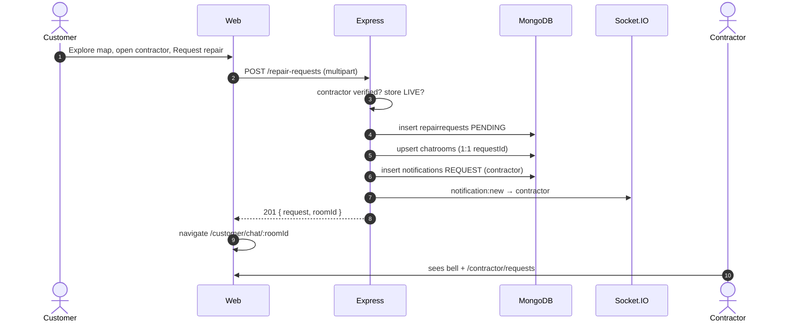
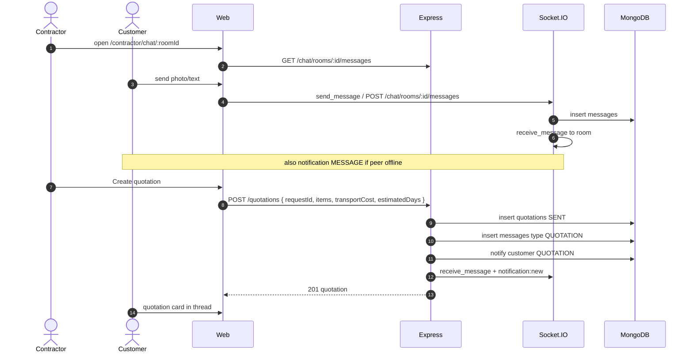
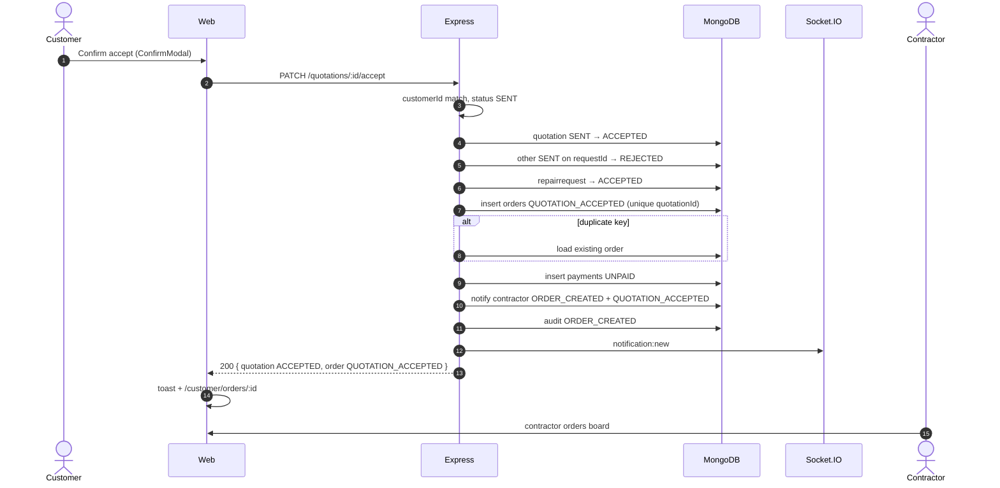
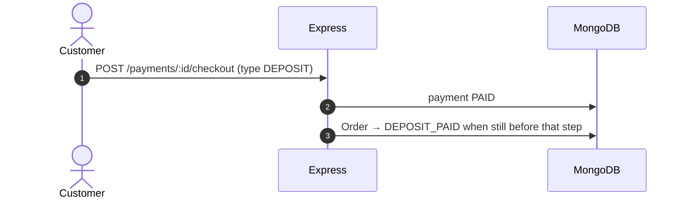
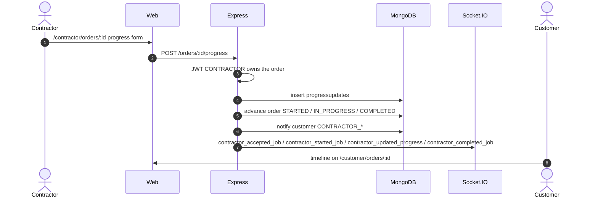
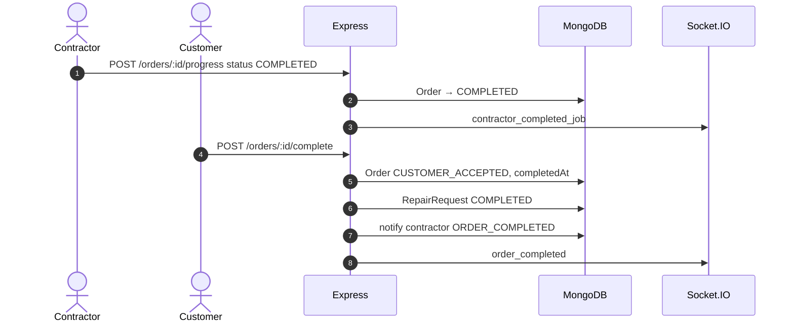
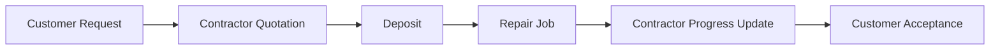

# Flow diagrams — Sprint 5 lock

All six sequences assume JWT already issued. Envelope and auth match [API.md](./API.md).  
Order factory and states: [ORDER_DESIGN.md](./ORDER_DESIGN.md). HTTP: [API_CONTRACT_SPRINT5.md](./API_CONTRACT_SPRINT5.md).

Legend: **solid** = existing Sprint 4; **bold notes** = Sprint 5 additions.

---

## Flow 1 — Customer creates Repair Request

Existing. Unchanged except notifications already fire.

**Failure:** unverified contractor → `400`; empty title → `422`.  
**No Order** at this step.

---

## Flow 2 — Chat and create Quotation

Existing. Unchanged.

**Rules:** contractor must own request; items ≥ 1; request not `REJECTED`.  
Multiple `SENT` quotes allowed until one is accepted.

---

## Flow 3 — Accept quotation creates Order

**Sprint 5 extends accept.** This is the architecture hinge.

The new order is `QUOTATION_ACCEPTED`. Deposit payment then moves it to `DEPOSIT_PAID`.

---

## Flow 4 — Deposit

---

## Flow 5 — Contractor progress

Progress status: `STARTED` `IN_PROGRESS` `COMPLETED`. Closed after `CUSTOMER_ACCEPTED` or `CANCELLED`.

---

## Flow 6 — Customer acceptance

Reviews are allowed only after `CUSTOMER_ACCEPTED`. Targets are the contractor and, when the order’s store is a material store, that store.

---

## End-to-end

---

## Timing vs collections

| Step | Writes |
| --- | --- |
| Flow 1 | repairrequests, chatrooms, notifications |
| Flow 2 | messages, quotations, notifications |
| Flow 3 | quotations, repairrequests, orders, payments, notifications, auditlogs |
| Flow 4 | payments, orders |
| Flow 5 | progressupdates, orders, notifications |
| Flow 6 | orders, repairrequests, notifications, auditlogs |
