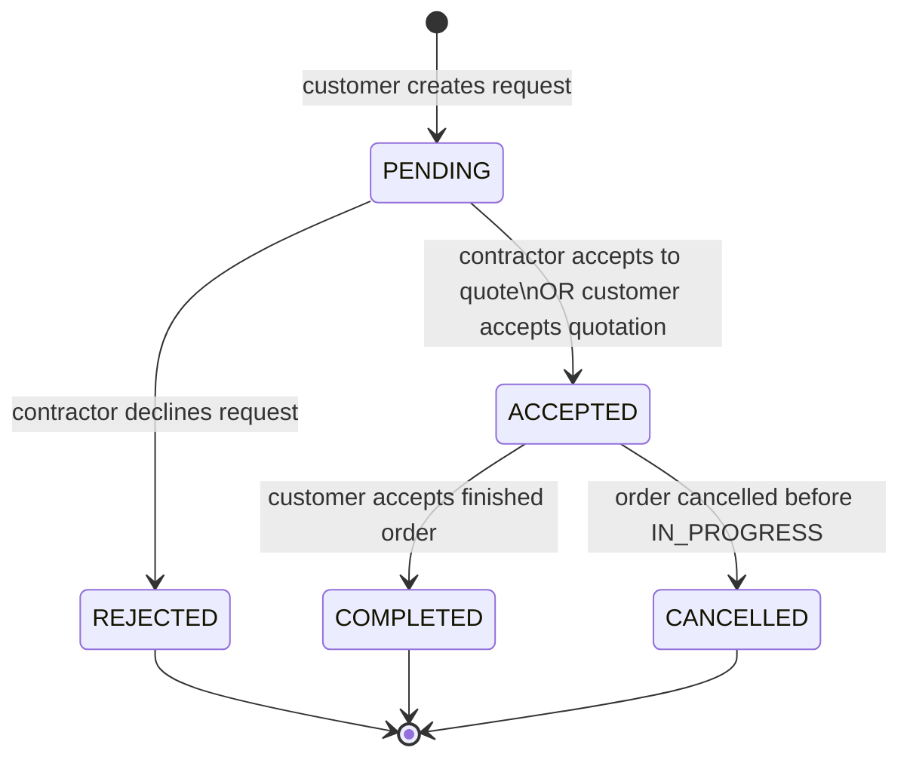
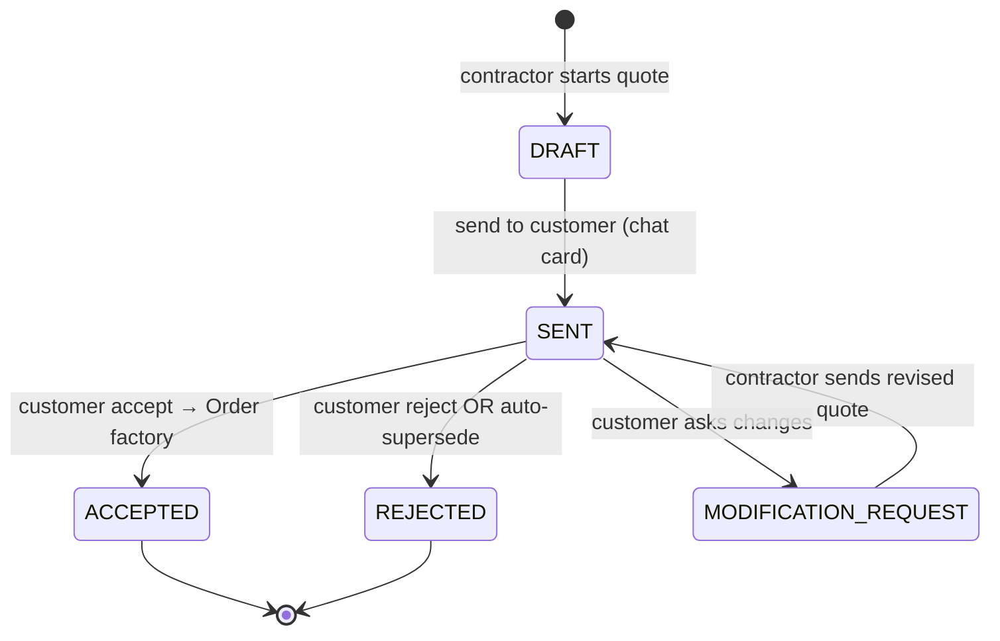
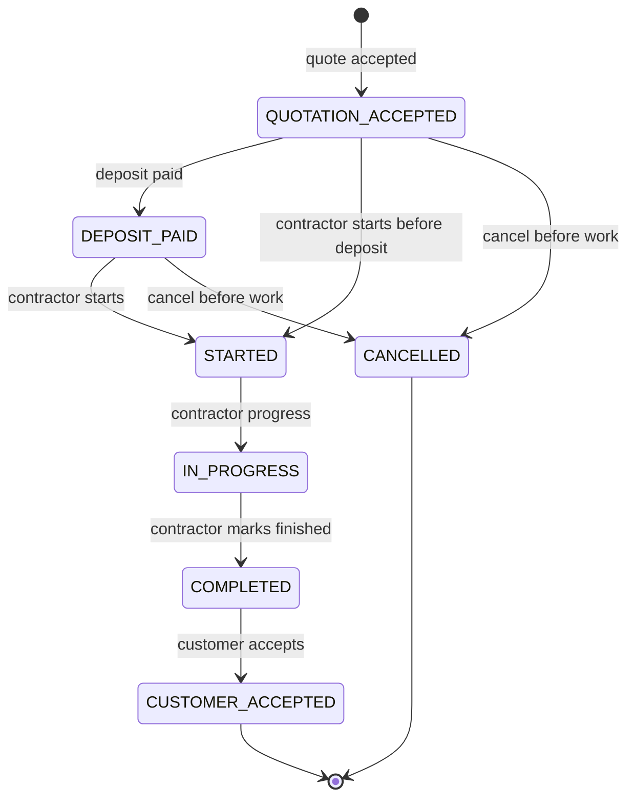
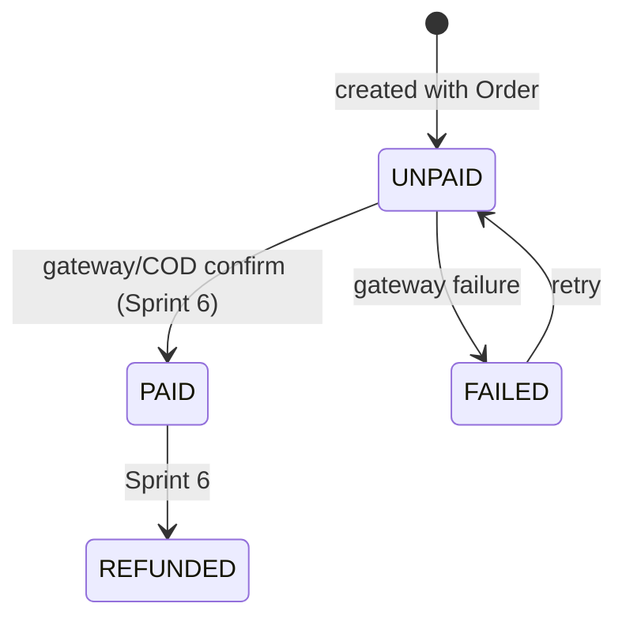

# Order design — Sprint 5 lock

This file is the **business kernel**. Schema: [DATABASE_FINAL.md](./DATABASE_FINAL.md). HTTP: [API_CONTRACT_SPRINT5.md](./API_CONTRACT_SPRINT5.md). Sequences: [FLOW_DIAGRAM.md](./FLOW_DIAGRAM.md).

---

## 1. What an Order is

An **Order** is the execution record of one accepted quotation.

It is **not**:

- a shopping cart
- a material-only checkout (that remains store catalog until a future commerce sprint)
- a second quotation

Snapshots copied onto the Order at birth (never live-joined later):

- `totalCost`, `materialCost`, `laborCost`, `transportCost`
- `estimatedDays`
- `items[]` (same shape as quotation items)
- `address` + GeoJSON from the RepairRequest
- `category`, `title`

If the customer needs a cheaper job after accept: **cancel** only while the job is `QUOTATION_ACCEPTED` or `DEPOSIT_PAID`, then send a new RepairRequest, or open a complaint. Do not mutate quotation line items on an existing Order.

---

## 2. Invariants

1. `Order.quotationId` unique. `Order.requestId` unique.
2. `Order.customerId` / `contractorId` copied from quotation; never reassigned.
3. Only the contractor on the order posts progress.
4. `Order.status === CUSTOMER_ACCEPTED` ⇒ `RepairRequest.status === COMPLETED`.
5. `Order.status === CANCELLED` is allowed only from `QUOTATION_ACCEPTED` or `DEPOSIT_PAID`.
6. Payment amount is the quotation snapshot. Later refunds do not rewrite that amount.

---

## 3. State machines

### 3.1 RepairRequest

Existing enum: `PENDING | ACCEPTED | REJECTED | COMPLETED`.  
Additive: `CANCELLED`.



**Meaning lock**

| Status | Meaning |
| --- | --- |
| `PENDING` | Waiting for contractor engagement and/or a winning quote |
| `ACCEPTED` | Commercial deal exists **or** contractor committed to quote. Order exists only if an ACCEPTED quotation exists |
| `REJECTED` | Contractor refused the brief. No order |
| `COMPLETED` | Customer signed off the work |
| `CANCELLED` | Order cancelled; request closed without work |

Contractor `PATCH /repair-requests/:id/accept` does **not** create an Order.

---

### 3.2 Quotation

Existing enum unchanged: `DRAFT | SENT | ACCEPTED | REJECTED | MODIFICATION_REQUEST`.



Rules:

- Only `SENT` can be accepted.
- On accept: all other `SENT` quotations for the same `requestId` become `REJECTED` (`meta.reason = SUPERSEDED`).
- `MODIFICATION_REQUEST` is not an edit-in-place of line items. Contractor sends a **new** `SENT` quotation (current create endpoint). Old row stays `MODIFICATION_REQUEST`.
- `DRAFT` may remain unused in UI; keep for API completeness.

---

### 3.3 Order



| Status | Who moves it | Meaning |
| --- | --- | --- |
| `QUOTATION_ACCEPTED` | system (quote accept) | Repair job exists |
| `DEPOSIT_PAID` | deposit payment | Customer paid the deposit |
| `STARTED` | contractor | Job accepted / started |
| `IN_PROGRESS` | contractor | Progress update |
| `COMPLETED` | contractor | Contractor finished; waiting for the customer |
| `CUSTOMER_ACCEPTED` | customer | Customer acceptance |
| `CANCELLED` | customer or contractor | Only before work starts |

```
Customer Request → Contractor Quotation → Deposit → Repair Job → Contractor Progress Update → Customer Acceptance
```

---

### 3.4 Payment



Sprint 5 **does not** move Payment out of `UNPAID`. The row exists so Order never gains a payment subdocument later.

`PENDING` is **not** used (avoid overlap with RepairRequest). Status is `UNPAID`.

---

## 4. Actor permissions (business)

| Action | CUSTOMER | CONTRACTOR | MATERIAL_STORE_OWNER | ADMIN |
| --- | --- | --- | --- | --- |
| Accept quotation → Order | yes | no | no | no |
| List own orders | yes | yes | no | yes |
| Post progress | no | yes | no | no |
| Accept finished job | yes, when `COMPLETED` | no | no | no |
| Cancel before work starts | yes | yes | no | yes |

---

## 5. Notification + audit (additive enums)

Notification types to add (existing ones stay):

`ORDER_CREATED` `CONTRACTOR_ACCEPTED_JOB` `CONTRACTOR_STARTED_JOB` `CONTRACTOR_UPDATED_PROGRESS` `CONTRACTOR_COMPLETED_JOB` `ORDER_COMPLETED`

Chat (`MESSAGE`) and payment (`PAYMENT_SUCCESS`, `PAYMENT_FAILED`) are separate.

Audit actions used by the job:

`ORDER_CREATED` `PROGRESS_UPDATED` `ORDER_COMPLETED`

---

## 6. Gap review — current product vs lock

### 6.1 Missing business (by sprint)

| Gap | Sprint to fill |
| --- | --- |
| No execution record after quote accept | **5** Order |
| No site diary / photos after chat | **5** ProgressUpdate |
| No customer acceptance | **5** `COMPLETED` → `CUSTOMER_ACCEPTED` |
| No money movement | **6** Payment gateway |
| `stores.rating` is seed-only | **6** Review aggregate |
| No dispute / refund | **6** Complaint |
| Contractor “accept request” vs “accept quote” naming clash | **5** docs + UI copy (not a new status) |
| Material stock never decrements | optional 5 (non-blocking), or 6 |
| No SLA / response-time clocks | 6+ |
| No multi-contractor bidding marketplace (one request is already 1 contractor) | out of scope — by design |
| No material-only checkout | out of scope |

### 6.2 Edge cases implementers must handle

| Case | Required behavior |
| --- | --- |
| Double-click accept quote | Idempotent Order |
| Two `SENT` quotes, accept one | Others `REJECTED` |
| Accept quote while request already `REJECTED` | `409` (already in quotation service) |
| Progress after `CUSTOMER_ACCEPTED` or `CANCELLED` | `409` |
| Customer accept while not `COMPLETED` | `409` |
| Cancel after work has started | `409` |
| Chat after acceptance | Allowed (read + text); no new quotations |

### 6.3 Security issues (now + Sprint 5)

| Issue | Severity | Mitigation (lock) |
| --- | --- | --- |
| IDOR on `/quotations/:id` if checks regress | high | Keep customer/contractor match |
| New `/orders/:id` must repeat membership check | high | service-level `assertOrderParty` |
| Stranger guessing an order id | high | customer or contractor membership |
| JWT in `localStorage` (XSS) | medium | Sprint 6 httpOnly cookie; not Sprint 5 |
| Progress photos on disk, no AV | medium | same as chat uploads; size/MIME only |
| Contractor posting progress on someone else's order | high | `contractorId` must match the JWT |
| Rate limit 400/15min may throttle photo bursts | low | keep; media already 60s timeout |
| `auditlogs.meta` Mixed — no PII dump of passwords | low | never log password hashes |
| Admin audit list unpaginated beyond 200 | low | cap already 200 |

### 6.4 Scalability

| Issue | Impact | Direction (not Sprint 5 work) |
| --- | --- | --- |
| Socket.IO in-process adapter | multi-instance chat breaks | Redis adapter when 2+ API nodes |
| `express.static` uploads | no CDN, disk on app server | S3-compatible in deploy hardening |
| Chat messages loaded all-at-once | large rooms | cursor pagination (additive API) |
| Nearby search: `$geoNear` then JS filters | OK for Can Tho demo | move category/rating into `$match` |
| `notifications` 40-item cap | OK | keep |
| `auditlogs` unbounded | disk | TTL 180 days later |
| Order list without compound index | slow contractor inbox | indexes in DATABASE_FINAL **required at implement** |
| One Mongo transaction per accept | needs replica set for transactions | if standalone Mongo, use ordered writes + unique index as the lock |

**Mongo transactions:** local Docker Mongo often runs as standalone (transactions fail). Implementers **must** use unique indexes on `orders.quotationId` as the concurrency lock, and emulate a transaction with:

1. `findOneAndUpdate` quote `SENT → ACCEPTED`
2. insert order (unique index rejects dupes)
3. if insert fails duplicate, reload existing order
4. then payment insert, request status, notifications

This is the **standalone-Mongo compatible** lock. Replica-set `startSession()` is optional.

---

## 7. UI copy (do not invent new statuses on screen)

| DB | vi | en |
| --- | --- | --- |
| QUOTATION_ACCEPTED | Đã chấp nhận báo giá | Quotation accepted |
| DEPOSIT_PAID | Đã đặt cọc | Deposit paid |
| STARTED | Đã bắt đầu | Started |
| IN_PROGRESS | Đang thi công | In progress |
| COMPLETED | Nhà thầu đã hoàn thành | Contractor finished |
| CUSTOMER_ACCEPTED | Khách đã nghiệm thu | Customer accepted |
| CANCELLED | Đã hủy | Cancelled |

---

## 8. Non-goals (reject if a PR sneaks them in)

- Recalculating `totalCost` from live catalog
- Multi-contractor on one RepairRequest
- A Worker role, roster, or assignment
- Customer posting progress
- Changing Leaflet stack
- Embedding Order inside Quotation
