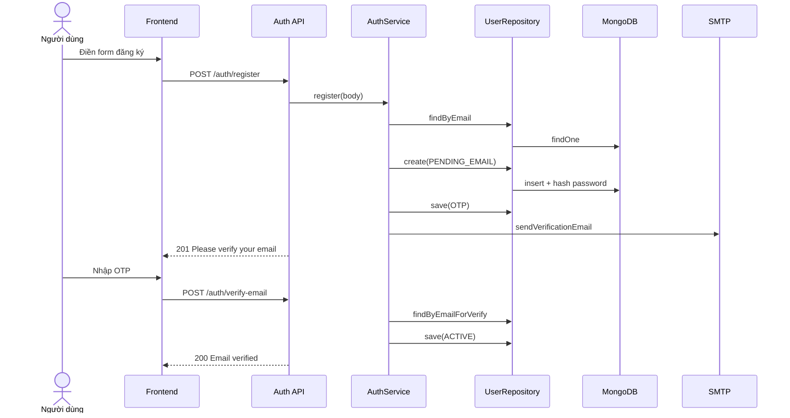
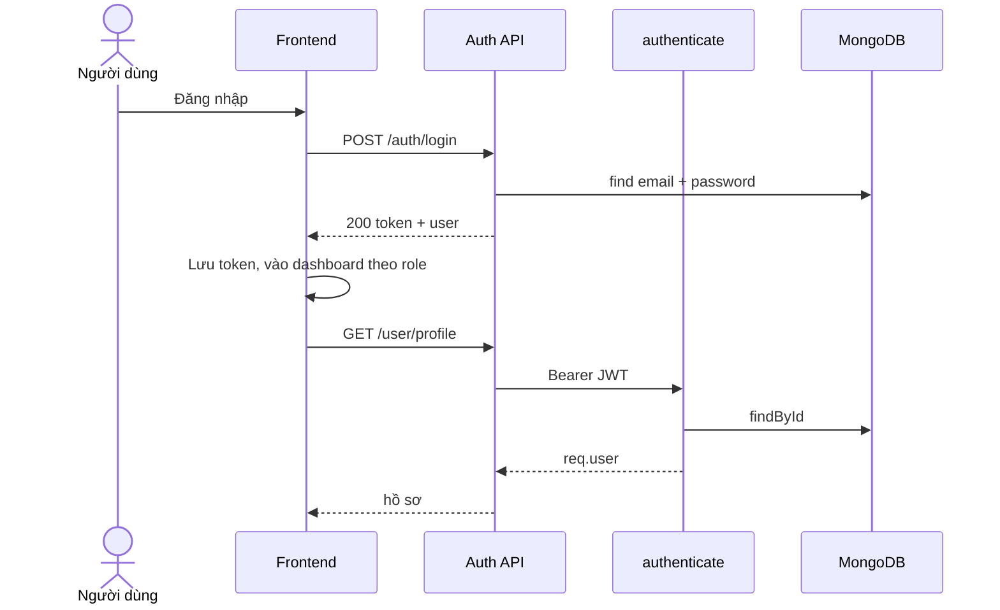

# Sprint 1 — Nền tảng tài khoản, xác thực và phân quyền

**Hệ thống:** BuildMate — nền tảng kết nối khách hàng, nhà thầu và cửa hàng vật liệu xây dựng địa phương.  
**Môn / sản phẩm:** Đồ án tốt nghiệp.  
**Phạm vi Sprint 1:** quản lý người dùng, đăng ký — xác thực email — đăng nhập JWT, quên mật khẩu, bảo vệ route theo vai trò, và cổng quản trị độc lập.  
**Ngoài phạm vi:** đặt lịch sửa chữa, báo giá, đơn hàng, thanh toán, hoa hồng (các sprint sau).

Tài liệu này mô tả **phần đã hiện thực** trên mã nguồn `BUILDMATE` (backend Express, frontend React, admin React), không phải bản thiết kế lý thuyết tách rời code.

---

## 1. Sprint Goal

Xây dựng **nền tảng định danh** cho toàn bộ nền tảng BuildMate, đảm bảo năm tác nhân nghiệp vụ và quản trị viên được nhận diện, xác thực và phân quyền thống nhất trước khi triển khai các nghiệp vụ sửa chữa — vật liệu.

Cụ thể, Sprint 1 nhằm:

1. Chuẩn hóa kiến trúc backend **Route → Controller → Service → Repository → Model → MongoDB**, tách rõ truy cập dữ liệu và nghiệp vụ.
2. Cho phép người dùng tự đăng ký với một trong bốn vai trò công khai, **xác thực email bằng OTP** rồi mới được đăng nhập.
3. Cấp **JWT** (`HS256`, payload `{ id, role }`) cho phiên làm việc; mật khẩu lưu **bcrypt** (cost 12), không trả về trường nhạy cảm.
4. Bảo vệ giao diện người dùng theo vai trò (Customer, Contractor, Material Store Owner).
5. Tách **Admin Portal** thành ứng dụng React riêng, chỉ tài khoản `ADMIN` (tạo bằng seed) được đăng nhập qua API admin.

**Tiêu chí hoàn thành sprint (Definition of Done):** người dùng hoàn tất vòng đăng ký → OTP → đăng nhập; token được gắn vào request; sai vai trò bị chặn; quản trị viên không dùng chung màn hình đăng nhập của user app.

---

## 2. User Stories

Các câu chuyện được viết theo mẫu *Với tư cách … tôi muốn … để …*. Ưu tiên P0 là bắt buộc trong Sprint 1.

| ID | Ưu tiên | User story | Tiêu chí chấp nhận (tóm tắt) |
| --- | --- | --- | --- |
| US-01 | P0 | **Với tư cách** khách chưa có tài khoản, **tôi muốn** đăng ký bằng họ tên, email, mật khẩu và vai trò, **để** tham gia nền tảng đúng tư cách của mình. | Email hợp lệ, mật khẩu ≥ 8 ký tự, vai trò thuộc bốn vai trò công khai; không tự đăng ký `ADMIN`; email trùng trả 409. |
| US-02 | P0 | **Với tư cách** người vừa đăng ký, **tôi muốn** nhận mã OTP 6 số qua email và xác thực, **để** kích hoạt tài khoản. | Tài khoản ở trạng thái `PENDING_EMAIL` cho đến khi OTP đúng và còn hạn (5 phút); xác thực xong `emailVerified = true`, `status = ACTIVE`. |
| US-03 | P0 | **Với tư cách** người dùng đã xác thực email, **tôi muốn** đăng nhập, **để** vào khu vực đúng vai trò. | Sai mật khẩu 401; chưa xác thực email 403; tài khoản bị khóa/từ chối 403; thành công trả JWT + hồ sơ công khai. |
| US-04 | P0 | **Với tư cách** hệ thống, **tôi muốn** mọi API cần đăng nhập kiểm JWT, **để** không lộ dữ liệu cho khách. | Thiếu/sai token 401; user không còn tồn tại 401; `BLOCKED`/`BANNED` 403. |
| US-05 | P0 | **Với tư cách** người dùng đã đăng nhập, **tôi muốn** được chuyển tới dashboard đúng vai trò và không vào khu vực vai trò khác, **để** giao diện khớp quyền. | Customer → `/customer/dashboard`; Contractor → `/contractor/dashboard`; cửa hàng → `/store/dashboard`. |
| US-06 | P1 | **Với tư cách** người quên mật khẩu, **tôi muốn** nhận OTP đặt lại mật khẩu, **để** khôi phục tài khoản mà không cần hỗ trợ thủ công. | Ba bước: gửi mã → kiểm tra mã → đặt mật khẩu mới; email không tồn tại không bị lộ (cùng thông báo thành công). |
| US-07 | P1 | **Với tư cách** người dùng, **tôi muốn** gửi lại OTP xác thực, **để** tiếp tục khi email đến chậm hoặc mã hết hạn. | Chỉ tài khoản chưa `emailVerified`; mã mới TTL 5 phút. |
| US-08 | P0 | **Với tư cách** quản trị viên, **tôi muốn** đăng nhập cổng Admin riêng, **để** vận hành hệ thống mà không lẫn với ứng dụng người dùng. | Chỉ `POST /api/admin/auth/login`; không phải ADMIN → 403; user app từ chối phiên ADMIN. |
| US-09 | P1 | **Với tư cách** người dùng đã đăng nhập, **tôi muốn** xem/sửa hồ sơ và đổi mật khẩu, **để** quản lý thông tin cá nhân. | `GET/PATCH /api/user/profile`, `PATCH /api/user/password` yêu cầu Bearer token. |
| US-10 | P2 | **Với tư cách** quản trị viên đã đăng nhập Admin Portal, **tôi muốn** thấy layout (sidebar, header, hồ sơ, đăng xuất), **để** làm việc trên một cổng thống nhất. | Protected route + RoleGuard `ADMIN`; logout xóa session local. |

---

## 3. Functional Requirements

### 3.1. Yêu cầu chức năng

| Mã | Mô tả | Ưu tiên |
| --- | --- | --- |
| FR-01 | Hệ thống cho phép đăng ký tài khoản với các trường: họ tên, email, mật khẩu, số điện thoại (tuỳ chọn), vai trò. | Must |
| FR-02 | Vai trò tự đăng ký chỉ gồm `CUSTOMER`, `CONTRACTOR`, `MATERIAL_STORE_OWNER`. `ADMIN` không xuất hiện trên form đăng ký. | Must |
| FR-03 | Sau đăng ký, hệ thống tạo bản ghi `users` với `status = PENDING_EMAIL`, `emailVerified = false`, phát OTP 6 số, gửi email (SMTP). Nếu SMTP chưa cấu hình, OTP được ghi ra console phục vụ môi trường phát triển. | Must |
| FR-04 | Xác thực email thành công chuyển tài khoản sang `ACTIVE` và xoá OTP đã dùng. | Must |
| FR-05 | Đăng nhập user app chỉ thành công khi mật khẩu đúng, email đã xác thực, tài khoản không bị `BLOCKED`/`BANNED`/`REJECTED`/`INACTIVE`, và **không** phải vai trò `ADMIN`. | Must |
| FR-06 | JWT được ký HS256, chứa `id` và `role`, thời hạn mặc định 7 ngày (`JWT_EXPIRES_IN`). Middleware xác thực đọc lại user từ cơ sở dữ liệu; **role hiệu lực lấy từ DB**, không tin role trong token đã cũ. | Must |
| FR-07 | Mật khẩu được hash bcrypt cost 12 tại hook `pre('save')` của model User; trường password `select: false`. | Must |
| FR-08 | Quên mật khẩu gồm gửi OTP, xác nhận OTP, đặt mật khẩu mới (tối thiểu 8 ký tự). | Should |
| FR-09 | Frontend bảo vệ route: chưa đăng nhập → `/login`; sai role → dashboard đúng role. | Must |
| FR-10 | Admin Portal là ứng dụng React độc lập (`admin/`, cổng 5174), đăng nhập qua `/api/admin/auth/login`. | Must |
| FR-11 | Envelope JSON thống nhất: `{ success, message, data }` khi thành công; `{ success: false, message, details, errors, data: null }` khi lỗi. Tiền tố `/api` và `/api/v1` cùng một router. | Must |
| FR-12 | Hồ sơ công khai (`toPublic`) không gồm password, OTP, reset token. | Must |

### 3.2. Yêu cầu phi chức năng (ràng buộc Sprint 1)

| Mã | Mô tả |
| --- | --- |
| NFR-01 | Backend không viết truy vấn Mongoose trong Controller; module User/Auth đi qua Repository. |
| NFR-02 | Mã nguồn đọc được ở mức đồ án (tên hàm rõ, ít lớp trừu tượng thừa). |
| NFR-03 | JWT verify chỉ chấp nhận thuật toán `HS256` (chặn `alg: none`). |
| NFR-04 | Rate limit riêng cho nhóm đường dẫn `/api/auth` và `/api/admin/auth`. |
| NFR-05 | CORS cho phép origin user app (5173) và admin app (5174). |

### 3.3. Phân tầng backend (bắt buộc)

```
HTTP Request
    → Route          (định nghĩa URL, validate, gắn middleware)
    → Controller     (nhận req, gọi service, trả envelope)
    → Service        (nghiệp vụ: OTP, so mật khẩu, cấp JWT)
    → Repository     (findByEmail, save, create — không chứa if nghiệp vụ)
    → Model          (schema Mongoose, hash password, toPublic)
    → MongoDB        (collection users)
```

Admin auth tái sử dụng `userRepository` và `signToken`; **không** dùng chung trang đăng nhập của `frontend/`.

---

## 4. Database Design

Sprint 1 tập trung collection **`users`**. Các collection nghiệp vụ (đơn hàng, chat, …) tồn tại trên cùng database nhưng **không thuộc phạm vi thiết kế Sprint 1**.

### 4.1. Vai trò (enum)

| Giá trị | Ý nghĩa | Nguồn tạo |
| --- | --- | --- |
| `CUSTOMER` | Chủ nhà / khách hàng | Tự đăng ký |
| `CONTRACTOR` | Nhà thầu | Tự đăng ký |
| `MATERIAL_STORE_OWNER` | Chủ cửa hàng vật liệu | Tự đăng ký |
| `ADMIN` | Quản trị hệ thống | Seed, không tự đăng ký |

### 4.2. Trạng thái tài khoản

| Giá trị | Dùng trong Sprint 1 |
| --- | --- |
| `PENDING_EMAIL` | Mặc định sau đăng ký, chờ OTP |
| `ACTIVE` | Sau khi xác thực email thành công |
| `PENDING_APPROVAL` | Dự phòng duyệt đối tác (sprint sau) |
| `REJECTED` | Từ chối — không cho đăng nhập |
| `BLOCKED` | Khóa — không cho đăng nhập |
| `INACTIVE`, `PENDING_VERIFICATION`, `BANNED` | Tương thích dữ liệu cũ / seed |

### 4.3. Lược đồ collection `users`

| Trường | Kiểu | Ràng buộc | Ghi chú |
| --- | --- | --- | --- |
| `_id` | ObjectId | PK | Định danh JWT `id` |
| `fullName`, `name` | String (2–80) | Đồng bộ qua hook | Hiển thị; API công khai trả cả hai |
| `email` | String | unique, lowercase, index | Định danh đăng nhập |
| `phone` | String | optional | |
| `password` | String | required, min 8, **select: false** | bcrypt |
| `role` | String | enum 5 vai trò, required | |
| `avatar` | String | default `''` | URL file upload |
| `status` | String | enum, default `PENDING_EMAIL` | |
| `emailVerified` | Boolean | default `false` | Điều kiện đăng nhập |
| `verificationCode` | String | select: false | OTP xác thực email |
| `verificationExpire` | Date | select: false | Hết hạn OTP (5 phút) |
| `resetPasswordToken` | String | select: false | OTP quên mật khẩu |
| `resetPasswordExpire` | Date | select: false | |
| `refreshToken` | String | select: false | Dự phòng, chưa dùng Sprint 1 |
| `preferredLanguage` | `vi` \| `en` | optional | |
| `location` | GeoJSON Point | default `[0,0]`, index `2dsphere` | Phục vụ tìm gần (sprint sau) |
| `createdAt`, `updatedAt` | Date | timestamps | |

**Chỉ mục:** `email` (unique), `{ role: 1, status: 1 }`, `location` 2dsphere.

### 4.4. Quan hệ logic (mức định danh)

```
ADMIN (1, seed) ─────────────┐
CUSTOMER (N)                 │
CONTRACTOR (N) ── cùng ──────┤── collection users
                             │     phân biệt bằng field role
MATERIAL_STORE_OWNER (N) ────┘
```

Một người = một document. Không tách bảng role. Phân quyền đọc `user.role` sau khi xác thực.

### 4.5. Quy tắc toàn vẹn liên quan auth

- Không trả `password` / OTP trong JSON (`toJSON` transform + `toPublic()`).
- OTP xác thực và OTP reset **dùng một lần** (xoá sau khi hợp lệ).
- Hash mật khẩu: nếu giá trị đã là chuỗi bcrypt (`$2…`) thì không hash lại (phục vụ seed).

---

## 5. API Documentation

**Base URL phát triển:** `http://localhost:5000`  
**Prefix:** `/api` (tương đương `/api/v1`).  
**Header phiên:** `Authorization: Bearer <jwt>`  
**Content-Type:** `application/json`

Mọi mô tả dưới đây là hợp đồng Sprint 1. Thành công: HTTP 2xx + `success: true`.

### 5.1. Đăng ký và xác thực email (công khai)

#### `POST /api/auth/register`

Tạo tài khoản, **không** trả JWT.

**Body**

```json
{
  "name": "Nguyen Van A",
  "email": "a@email.com",
  "password": "Matkhau1",
  "phone": "0900000000",
  "role": "CUSTOMER"
}
```

`role` ∈ `CUSTOMER` | `CONTRACTOR` | `MATERIAL_STORE_OWNER`.

| HTTP | Ý nghĩa |
| --- | --- |
| 201 | Đã tạo, cần xác thực email |
| 409 | Email đã tồn tại |
| 422 | Validate (Zod) |

**201**

```json
{
  "success": true,
  "message": "Please verify your email",
  "data": null
}
```

#### `POST /api/auth/verify-email`

```json
{ "email": "a@email.com", "code": "123456" }
```

| HTTP | Ý nghĩa |
| --- | --- |
| 200 | Đã xác thực |
| 400 | Sai mã, hết hạn, đã xác thực |
| 404 | Không có tài khoản |

#### `POST /api/auth/resend-code`

```json
{ "email": "a@email.com" }
```

### 5.2. Đăng nhập / đăng xuất user app

#### `POST /api/auth/login`

```json
{ "email": "a@email.com", "password": "Matkhau1" }
```

**200**

```json
{
  "success": true,
  "message": "Login successful",
  "data": {
    "token": "<jwt>",
    "user": {
      "id": "...",
      "fullName": "Nguyen Van A",
      "name": "Nguyen Van A",
      "email": "a@email.com",
      "phone": "",
      "avatar": "",
      "role": "CUSTOMER",
      "status": "ACTIVE",
      "emailVerified": true,
      "createdAt": "...",
      "updatedAt": "..."
    }
  }
}
```

| HTTP | Ý nghĩa |
| --- | --- |
| 401 | Email hoặc mật khẩu sai |
| 403 | Chưa xác thực email; tài khoản bị khóa/từ chối; **tài khoản ADMIN** (phải dùng Admin Portal) |

#### `POST /api/auth/logout`

Yêu cầu Bearer token. Server không thu hồi JWT (stateless); client xoá token local.

### 5.3. Quên mật khẩu

| Method | Path | Body | Ghi chú |
| --- | --- | --- | --- |
| POST | `/api/auth/forgot-password` | `{ "email" }` | Luôn thông báo đã gửi mã (không enumeration) |
| POST | `/api/auth/verify-reset-code` | `{ "email", "code" }` | OTP 6 số |
| POST | `/api/auth/reset-password` | `{ "email", "code", "newPassword" }` | Mật khẩu mới ≥ 8 |

### 5.4. Hồ sơ người dùng (đã đăng nhập)

| Method | Path | Mô tả |
| --- | --- | --- |
| GET | `/api/user/profile` | Hồ sơ công khai |
| PATCH | `/api/user/profile` | `fullName`/`name`, `phone`, `preferredLanguage` |
| PATCH | `/api/user/password` | `{ currentPassword, newPassword }` |
| POST | `/api/user/avatar` | `multipart/form-data`, field `avatar` |

### 5.5. Admin Portal (tách biệt)

| Method | Path | Auth | Mô tả |
| --- | --- | --- | --- |
| POST | `/api/admin/auth/login` | Không | Chỉ `role = ADMIN` mới nhận JWT |
| GET | `/api/admin/auth/me` | Bearer + `allowRole('ADMIN')` | Hồ sơ admin |
| POST | `/api/admin/auth/logout` | Bearer + ADMIN | Xác nhận logout |

**403** nếu đăng nhập admin bằng tài khoản Customer/Contractor/Store.

### 5.6. Mã lỗi thường gặp

| HTTP | Khi nào |
| --- | --- |
| 401 | Không có token, token hết hạn/sai, mật khẩu sai |
| 403 | Sai vai trò, chưa verify email, tài khoản bị đình chỉ |
| 404 | Không tìm thấy tài khoản (verify / reset) |
| 409 | Email đăng ký trùng |
| 422 | Body không qua schema Zod |

---

## 6. Authentication Flow

### 6.1. Nguyên tắc

1. **Hai cổng đăng nhập.** User app gọi `/api/auth/login`. Admin app gọi `/api/admin/auth/login`. Không dùng chung form.
2. **Email trước, phiên sau.** Register không cấp token. Chỉ login sau `emailVerified`.
3. **Mật khẩu không lưu plaintext.** So sánh bằng `comparePassword` (bcrypt).
4. **Phân quyền hai lớp.** (a) Middleware `authenticate` + `allowRole` trên API. (b) `ProtectedRoute` trên React theo `user.role`.
5. **ADMIN không vào user frontend.** Backend từ chối login admin trên `/auth/login`; frontend xoá session nếu profile trả `ADMIN`.

### 6.2. Lưu phiên phía client

| Ứng dụng | Thư mục | Lưu token | Gắn header |
| --- | --- | --- | --- |
| User | `frontend/` | `localStorage` khóa `buildmate-token` / `buildmate-user` | Axios interceptor |
| Admin | `admin/` | Zustand persist `buildmate-admin-auth` | Axios interceptor riêng |

Khôi phục phiên: User gọi `GET /api/user/profile`; Admin gọi `GET /api/admin/auth/me`.

### 6.3. Ánh xạ vai trò → đường dẫn

| `role` | Dashboard sau login |
| --- | --- |
| `CUSTOMER` | `/customer/dashboard` |
| `CONTRACTOR` | `/contractor/dashboard` |
| `MATERIAL_STORE_OWNER` | `/store/dashboard` |
| `ADMIN` | Admin Portal `/dashboard` (app cổng 5174) |

### 6.4. JWT

- Thuật toán: **HS256**.
- Secret: biến môi trường `JWT_SECRET` (khuyến nghị ≥ 32 ký tự).
- Payload: `{ id, role, iat, exp }`.
- Middleware từ chối token thiếu `role` hoặc không resolve được user.

Logout Sprint 1 là **client-side** (xoá token). Token còn hạn vẫn verify được cho đến `exp` — phù hợp mô hình JWT stateless của đồ án; blacklist là hướng mở rộng.

---

## 7. Sequence Diagram Description

Phần này mô tả tương tác theo thời gian, đủ để vẽ lại trên StarUML / draw.io / mermaid trong báo cáo.

### 7.1. Đăng ký và xác thực email

**Tác nhân:** Người dùng, Frontend, AuthController, AuthService, UserRepository, MongoDB, EmailProvider (SMTP).

1. Người dùng gửi form đăng ký. Frontend `POST /api/auth/register`.
2. Route chạy `registerSchema`. Controller gọi `authService.register`.
3. Service kiểm tra vai trò công khai; Repository `findByEmail`. Trùng → 409.
4. Repository `create` user `PENDING_EMAIL`. Model `pre('save')` hash mật khẩu.
5. Service sinh OTP 6 số (`crypto.randomInt`), lưu `verificationCode` + `verificationExpire`, `save`.
6. EmailProvider gửi thư; nếu chưa có SMTP thì ghi OTP ra console.
7. API trả 201. Frontend điều hướng `/verify-email?email=...`.
8. Người dùng nhập OTP. `POST /api/auth/verify-email`.
9. Service đọc user kèm OTP; kiểm tra hạn; so sánh mã (`timingSafeEqual`).
10. Cập nhật `emailVerified`, `status = ACTIVE`, xoá OTP. Trả 200. Frontend về `/login`.



### 7.2. Đăng nhập user app và điều hướng vai trò

1. `POST /api/auth/login` với email, mật khẩu.
2. Repository lấy user kèm password. Sai thông tin → 401 (cùng thông báo).
3. Nếu `role = ADMIN` → 403 (yêu cầu Admin Portal).
4. Nếu chưa verify / bị khóa → 403.
5. `signToken({ id, role })`. Trả token + `toPublic()`.
6. Frontend lưu token, `navigate` theo `ROLE_HOME[role]`.
7. Request sau: interceptor gắn Bearer. `authenticate` verify JWT, `findById`, gán `req.user` từ DB.



### 7.3. Quên mật khẩu

1. `POST /auth/forgot-password`. Nếu không có email, vẫn trả thông báo đã gửi (chống dò email).
2. Nếu có user: lưu OTP reset, gửi mail.
3. `POST /auth/verify-reset-code` kiểm tra mã.
4. `POST /auth/reset-password` gán mật khẩu mới (model hash), xoá OTP.

### 7.4. Đăng nhập Admin Portal

1. Admin app (cổng 5174) `POST /api/admin/auth/login`.
2. `adminAuthService` so mật khẩu; **bắt buộc** `role === ADMIN`.
3. Cấp JWT cùng cơ chế `signToken`.
4. `ProtectedRoute` / `RoleGuard` chỉ cho `ADMIN`. Sidebar + header + hồ sơ + logout.
5. `GET /api/admin/auth/me` để khôi phục phiên.

User app **không** chứa route `/admin/*` sau Sprint 1.

---

## 8. Testing Scenario

Kịch bản kiểm thử chức năng (manual / Postman / UI). Môi trường: MongoDB local, backend `:5000`, frontend `:5173`, admin `:5174`. Khi chưa gắn SMTP, đọc OTP trên terminal backend.

### 8.1. Đăng ký — OTP — đăng nhập (happy path)

| Bước | Hành động | Kết quả mong đợi |
| --- | --- | --- |
| 1 | Mở `/register`, chọn Customer, điền form hợp lệ | Không lỗi validate phía UI |
| 2 | Gửi đăng ký | 201; không có `token` trong body |
| 3 | Kiểm tra MongoDB | `status = PENDING_EMAIL`, `emailVerified = false`, password dạng `$2` |
| 4 | Nhập OTP đúng trên `/verify-email` | 200; `status = ACTIVE` |
| 5 | Đăng nhập đúng mật khẩu | 200, có JWT; vào `/customer/dashboard` |
| 6 | Gọi `GET /api/user/profile` kèm Bearer | 200, không có field password |

### 8.2. Các trường hợp từ chối

| ID | Tình huống | Kỳ vọng |
| --- | --- | --- |
| T-01 | Đăng ký trùng email | 409 |
| T-02 | Đăng ký `role: ADMIN` (gọi API trực tiếp) | 400 / 422 (không thuộc enum công khai) |
| T-03 | Đăng nhập khi chưa verify | 403, frontend chuyển `/verify-email` |
| T-04 | OTP sai | 400 |
| T-05 | OTP quá 5 phút | 400 expired |
| T-06 | Sai mật khẩu | 401, message không tiết lộ email có tồn tại hay không |
| T-07 | Vào `/contractor/dashboard` bằng token Customer | Frontend redirect về dashboard Customer |
| T-08 | Gọi API contractor không kèm token | 401 |
| T-09 | Customer gọi API chỉ dành ADMIN | 403 |
| T-10 | User app login bằng `admin@buildmate.vn` | 403 Admin Portal |
| T-11 | Admin Portal login bằng tài khoản Customer | 403 Forbidden |
| T-12 | `?next=//evil.com` sau login | Không redirect ra ngoài origin (chỉ path nội bộ) |

### 8.3. Quên mật khẩu

| Bước | Kỳ vọng |
| --- | --- |
| Email không tồn tại | 200, cùng message như email tồn tại |
| OTP đúng → mật khẩu mới | Đăng nhập được bằng mật khẩu mới, mật khẩu cũ thất bại |
| OTP hết hạn | 400 |

### 8.4. Admin Portal

| Bước | Kỳ vọng |
| --- | --- |
| Login đúng ADMIN | Vào layout sidebar / header |
| Reload trang | `GET /admin/auth/me` khôi phục user |
| Logout | Hết session, về `/login` |
| Token user thường dán vào Admin API | 403 |

### 8.5. Kiểm thử tự động hiện có

Backend: `npm test` (Node test runner). Bộ test hồi quy toàn repo (kể cả sprint sau) phải **pass**, gồm login HTTP `POST /api/auth/login` trên tài khoản fixture đã `emailVerified`.

---

## 9. Sprint Result

### 9.1. Sản phẩm giao được

| Hạng mục | Kết quả |
| --- | --- |
| Kiến trúc Auth/User | Đủ 6 lớp; `UserRepository` kế thừa `BaseRepository`; Controller không chứa nghiệp vụ |
| Model User | 5 vai trò, trạng thái, OTP, geo dự phòng, `toPublic()` |
| API user | Register, verify, resend, login, logout, forgot/reset password, profile |
| API admin auth | Login / me / logout riêng |
| Bảo mật tối thiểu | bcrypt 12, JWT HS256, OTP TTL 5 phút, ẩn field nhạy cảm, rate limit auth |
| Frontend user | Trang Login, Register, VerifyEmail, ForgotPassword; `AuthContext`; `ProtectedRoute` |
| Admin Portal | App React `admin/`, layout + protected route, không dùng chung bundle `frontend/` |
| Envelope & versioning | `/api` và `/api/v1` cùng handler |

### 9.2. Đối chiếu mục tiêu

| Mục tiêu sprint | Trạng thái |
| --- | --- |
| Người dùng tự đăng ký 4 vai trò | Hoàn thành |
| Bắt buộc xác thực email trước login | Hoàn thành |
| JWT + bảo vệ API/UI theo role | Hoàn thành |
| Admin tách ứng dụng và API login | Hoàn thành |
| Repository cho module User/Auth | Hoàn thành |
| Thanh toán / đơn hàng / chat | **Không thuộc Sprint 1** (đã có ở sprint khác trên cùng repo) |

### 9.3. Ràng buộc còn lại (ghi nhận cho báo cáo)

1. Logout **không** đưa JWT vào blacklist; phiên kết thúc khi client xoá token hoặc token hết hạn.
2. OTP lưu dạng plaintext trong MongoDB, `select: false`, TTL ngắn — đủ cho đồ án; có thể hash OTP ở sprint bảo mật nâng cao.
3. Các module ngoài User (chat, đơn hàng, …) có thể vẫn gọi Mongoose trực tiếp; không làm thay đổi phạm vi Sprint 1.
4. Tài khoản `ADMIN` chỉ nên tạo bằng script seed, không qua API đăng ký công khai.

### 9.4. Kết luận

Sprint 1 thiết lập **lớp định danh và kiểm soát truy cập** của BuildMate: một collection `users`, hai cổng đăng nhập (người dùng và quản trị), luồng OTP email, JWT thống nhất và bảo vệ giao diện theo vai trò. Các sprint nghiệp vụ sau tái sử dụng `authenticate`, `allowRole` và payload `{ id, role }` mà không phải thiết kế lại mô hình tài khoản.

---

*Tài liệu bám mã nguồn thư mục `backend/src` (auth, user, adminAuth), `frontend/src` (auth pages, AuthContext, ProtectedRoute) và `admin/src`. Khi code đổi hợp đồng API, cần cập nhật mục 5 cho khớp báo cáo.*
