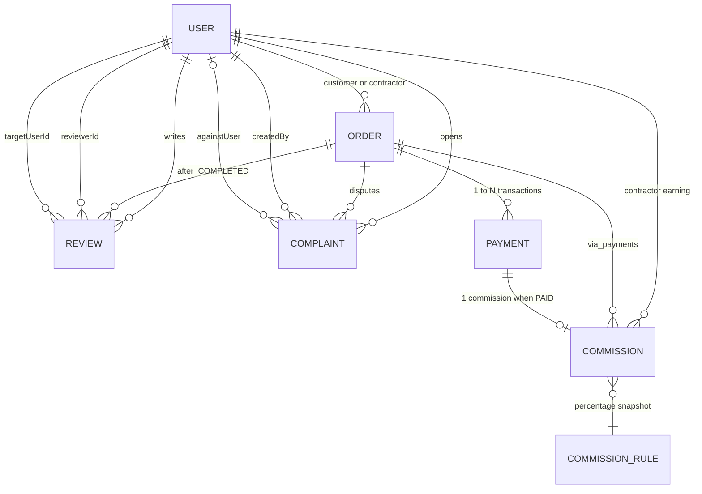

# Sprint 6 — Architecture Lock

**Status:** LOCKED — design only. Do not implement in this sprint.  
**Scope:** Payment capture, commission ledger, review & rating, complaint / dispute, admin business analytics.  
**Out of scope:** Real payment gateway keys (MoMo/Stripe live), bank payout to contractors, React Native, commission tax invoices.

Companion docs:

| File | Content |
| --- | --- |
| [PAYMENT_DESIGN.md](./PAYMENT_DESIGN.md) | Lifecycle, types, 1:N transactions, state machine |
| [COMMISSION_DESIGN.md](./COMMISSION_DESIGN.md) | Fee rules, ledger, admin-editable % |
| [REVIEW_DESIGN.md](./REVIEW_DESIGN.md) | Who rates whom, aggregates |
| [COMPLAINT_DESIGN.md](./COMPLAINT_DESIGN.md) | Dispute workflow |
| [BUSINESS_FLOW_SPRINT6.md](./BUSINESS_FLOW_SPRINT6.md) | End-to-end business spine (VI + diagrams) |

Where this pack conflicts with [DATABASE_FINAL.md](./DATABASE_FINAL.md) on payment cardinality, **this pack wins**. Collection names, auth, and existing HTTP paths stay. There is no Worker role.

---

## 1. What stays frozen

Do **not** rename or drop:

`users` `contractorprofiles` `stores` `services` `materials` `repairrequests` `chatrooms` `messages` `quotations` `notifications` `auditlogs` `orders` `progressupdates` `payments`

Do **not** change:

- JWT `{ sub, role }` HS256
- Envelope `{ success, message, data, details, errors }`
- Roles `CUSTOMER | CONTRACTOR | MATERIAL_STORE_OWNER | ADMIN`
- `PATCH /quotations/:id/accept` as the only Order factory
- Existing `/api/orders/*` and `/api/orders/:id/progress` (contractor only)

**Allowed:** additive enums, additive fields, **drop unique `payments.orderId`** (the one structural fix required for deposit + final), new collections `commissions` `commissionrules` `reviews` `complaints`.

---

## 2. Business spine (locked)

```
Customer Request
  → Contractor Quotation
  → Deposit
  → Repair Job
  → Contractor Progress Update
  → Customer Acceptance
  → Review (contractor, and material store when the order uses one)
  → Optional complaint (customer or contractor + admin)
```

Money: **customer pays BuildMate** (platform is merchant of record for the thesis). Contractor earning is a **ledger** (`commissions.contractorAmount`), not a live bank transfer in Sprint 6.

---

## 3. Cardinality (Sprint 6)

| From | To | Rule |
| --- | --- | --- |
| Order | Payment | **1:N** transactions (`DEPOSIT`, `FINAL_PAYMENT`, or single `FULL_PAYMENT`) |
| Order | `orders.paymentStatus` | 1 rollup: `UNPAID` `PENDING` `PAID` `FAILED` `REFUNDED` |
| Payment (PAID) | Commission | **1:1** |
| Order | Review | **0:N** — unique `(orderId, reviewerId, targetType, targetUserId)` |
| Order | Complaint | **0:N** |
| Platform | CommissionRule | 1 active rule; history kept |

Sprint 5 GET `/orders/:id` nested `payment` **remains**. It becomes a **summary** (`status`, `amount` = order total, `paidAmount`, `remainingAmount`). Array `payments[]` is additive.

---

## 4. Additive enums

| Location | Additive values | Notes |
| --- | --- | --- |
| `PAYMENT_STATUS` | `PENDING` | Checkout started, webhook not success |
| `orders.status` | `DISPUTED` | Optional; set when an `OPEN`/`PROCESSING` complaint exists on an in-flight order. Do not delete `CANCELLED` / `COMPLETED`. |
| Notification types | `PAYMENT_PAID` `PAYMENT_FAILED` `REVIEW_RECEIVED` `COMPLAINT_OPENED` `COMPLAINT_UPDATED` | Additive |
| Audit actions | `PAYMENT_CHECKOUT` `PAYMENT_PAID` `COMMISSION_CREATED` `REVIEW_CREATED` `COMPLAINT_*` `FEE_CHANGED` | Additive |

`DISPUTED` is **not** required to complete a paid happy path. If adding it in 6.1 threatens the Sprint 5 state machine tests, keep complaint as a side document first and add `DISPUTED` in 6.1 only if tests stay green.

---

## 5. New / extended collections

| Collection | Sprint 5 | Sprint 6 |
| --- | --- | --- |
| `payments` | 1 UNPAID row, unique `orderId` | 1:N, types, method, providerRef, idempotencyKey |
| `commissionrules` | — | Admin-editable % (default 5) |
| `commissions` | — | Immutable snapshot per PAID payment |
| `reviews` | designed, not coded | Write after `Order.COMPLETED` |
| `complaints` | designed, not coded | Parties open; admin resolves |

Field dictionaries: payment / commission / review / complaint design docs.

---

## 6. ERD (updated)



---

## 7. Security rules (summary)

| Resource | Create | Read | Update status |
| --- | --- | --- | --- |
| Payment checkout | CUSTOMER of that order | Parties of the order | Gateway webhook (HMAC) or ADMIN refund |
| Commission | System on PAID only | CONTRACTOR own; ADMIN all | ADMIN reverse on refund only |
| Commission % | ADMIN | ADMIN | ADMIN (future payments only) |
| Review | CUSTOMER, order `CUSTOMER_ACCEPTED` | Public contractor and material-store scores | **Immutable** (no edit/delete in 6.x) |
| Complaint | CUSTOMER or CONTRACTOR on the order | Opener + accused + ADMIN | ADMIN `PROCESSING` `RESOLVED` `REJECTED` |
| Analytics | — | ADMIN | — |

IDOR: every `orderId` / `paymentId` must `assertParty` or `assertAdmin`. Webhook has **no JWT**; verify `x-buildmate-signature`. Idempotency-Key on checkout. Never trust `amount` from the client — server uses the payment row.

---

## 8. API contract (index)

Base: existing `/api` and `/api/v1` (alias). Full request/response in the domain docs; this table is the lock list.

| Method | Path | Auth | Purpose |
| --- | --- | --- | --- |
| GET | `/orders/:id/payments` | party | List transactions + rollup |
| POST | `/payments/:id/checkout` | CUSTOMER | Start UNPAID → PENDING |
| POST | `/payments/webhook` | signature | Mock/gateway callback |
| POST | `/admin/payments/:id/refund` | ADMIN | PAID → REFUNDED + reverse commission |
| GET | `/contractor/earnings` | CONTRACTOR | Own commissions |
| GET | `/admin/commissions` | ADMIN | Ledger |
| GET | `/admin/settings/commission` | ADMIN | Active rule |
| PATCH | `/admin/settings/commission` | ADMIN | New % (new rule row) |
| POST | `/reviews` | CUSTOMER | Create |
| GET | `/reviews/user/:id` | public/auth | Filter `targetType=CONTRACTOR` or `MATERIAL_STORE` |
| GET | `/orders/:id/reviews` | party | Reviews for that job |
| POST | `/complaints` | CUSTOMER CONTRACTOR | Open |
| GET | `/complaints/my` | same | Own complaints |
| GET | `/admin/complaints` | ADMIN | Queue |
| PATCH | `/admin/complaints/:id` | ADMIN | Status + adminNote |
| GET | `/admin/analytics` | ADMIN | Dashboard aggregates |

**Forbidden:** `POST /payments` (clients do not invent amounts). `POST /commissions`. `PATCH /reviews`. Customer `PATCH /complaints` except no-op.

---

## 9. Analytics data source (locked)

**Primary: realtime Mongo aggregations** on `users`, `orders`, `payments`, `commissions`, `services` — indexed, cached **60 seconds in process memory** (or Redis later).

**Rejected for Sprint 6:** a `dailystats` collection. Thesis volume is tiny; a second write path would drift from source of truth.

**Revisit** only if admin dashboard p95 > 2s.

Metrics:

- Users: total, by role (`CUSTOMER` `CONTRACTOR` `MATERIAL_STORE_OWNER` `ADMIN`)
- Orders: total, `COMPLETED`, `CANCELLED` (and in-flight count)
- Finance: `SUM(payments.amount)` where `PAID`; `SUM(commissions.platformAmount)`; `SUM(commissions.contractorAmount)`
- Marketplace: top services by order title/category join via `repairrequests.category`; top contractors by `COMPLETED` count and `stores.rating`

---

## 10. Edge cases (index)

See domain docs. Must-handle in 6.1 tests:

| ID | Case | Expected |
| --- | --- | --- |
| P1 | Checkout twice / double webhook | 1 PAID row; second call 200 idempotent or 409 |
| P2 | FAILED then retry | New attempt on same row UNPAID←FAILED or same id retry |
| P3 | Refund | PAID → REFUNDED; commission REVERSED; rollup REFUNDED |
| R1 | Review before `CUSTOMER_ACCEPTED` | 409 |
| R2 | Two reviews same target same order | 409 unique index |
| R3 | Contractor self-review | 403 |
| C1 | Complaint after 7 days from COMPLETED | 409 (admin may still open internally — not in 6.1) |
| C2 | Many complaints same order | Allowed |
| F1 | Fee 5% → 8% | Old commissions keep 5; new PAID use 8 |
| W1 | Material store review when the order has no materials store | 400 |

---

## 11. Implementation plan — Sprint 6.1 Backend

1. Additive `PENDING` on payment status; drop unique `orderId` on `payments`; add `type` `method` `providerRef` `idempotencyKey` `paidAt` `customerId` `contractorId`. Backfill existing rows: `type = FULL_PAYMENT`.
2. `PaymentProvider` interface + **MockProvider** (and optional `BANK_TRANSFER` manual confirm by admin). No live MoMo.
3. Checkout + webhook + rollup `orders.paymentStatus`.
4. `commissionrules` seed 5%. `commissions` insert in the same transaction as PAID.
5. `reviews` + recompute `stores.rating` / `reviewCount` for contractors and `materialRating` / `materialReviewCount` for material stores.
6. `complaints` + admin PATCH; notifications + audit.
7. `GET /admin/analytics` aggregations.
8. Tests: P1–P3, R1–R2, C2, F1, IDOR 403. `npm test` green including Sprint 5.3.

Deposit is optional before the contractor starts. A paid deposit still sets `DEPOSIT_PAID` when the job has not passed that step.

---

## 12. Implementation plan — Sprint 6.2 Frontend

1. Customer: payment panel on order detail (amount due, method, mock “Pay now”).
2. Contractor: earnings page (ledger, not a bank balance).
3. After `CUSTOMER_ACCEPTED`: review the contractor, and the material store when the order has one.
4. Complaint form on order detail for the customer and the contractor.
5. Admin: finance + complaints queue + commission % + analytics cards. Reuse Construction OS, QueryState, ConfirmModal.
6. Toasts on `PAYMENT_PAID` / `REVIEW_RECEIVED` / `COMPLAINT_*`.
7. i18n `vi`/`en` namespace `finance` + `reviews` + `complaints`.
8. `npm run build` green. No RN.

---

## 13. Decision log

| ID | Decision | Rejected | Why |
| --- | --- | --- | --- |
| S6-D1 | Keep collection `payments`, change 1:1 → 1:N | New `paymenttransactions` + keep unique | One name already in API/seed; avoid two sources of amount |
| S6-D2 | GET order `payment` stays as **rollup** | Breaking rename | Sprint 5.2 UI |
| S6-D3 | Default path `FULL_PAYMENT` 100% | Force 30/70 for every job | Demo + existing UNPAID rows |
| S6-D4 | Split DEPOSIT+FINAL allowed, policy default off | Always split | Additive |
| S6-D5 | Platform is merchant of record | Direct customer→contractor transfer | Commission needs a single capture |
| S6-D6 | Contractor payout is ledger only | Auto-disburse | No KYC/bank in thesis |
| S6-D7 | Default fee 5%, snapshot on PAID | Live % on historical rows | Fee change must not rewrite past |
| S6-D8 | Customer reviews the contractor and, when applicable, the material store | Two-way reviews | Marketplace trust is supply-side |
| S6-D9 | Reviews immutable | Edit window | Anti-spam |
| S6-D10 | Customer and contractor may open complaints | Customer-only | The contractor needs a path to escalate |
| S6-D11 | Analytics = live aggregate + 60s cache | `dailystats` collection | No drift at thesis scale |
| S6-D12 | Mock gateway | Live MoMo in 6.1 | Secrets, sandbox accounts, demo reliability |
| S6-D13 | Pay **not** gated on COMPLETED for FULL/DEPOSIT | Pay only after handover | Deposit-before-work is optional later |
| S6-D14 | `FINAL_PAYMENT` when `COMPLETED` or `CUSTOMER_ACCEPTED` | Final anytime | The contractor has finished the job |

---

## 14. Freeze test

Sprint 6 is correctly designed if:

1. No Sprint 1–5 collection is dropped; `payments` name is unchanged.
2. Accept quote still creates exactly one Order and at least one UNPAID payment.
3. A second PAID webhook cannot create a second commission for the same `paymentId`.
4. Reviews cannot exist unless `orders.status === COMPLETED`.
5. Admin fee change does not mutate existing `commissions.percentage`.
6. Existing order HTTP paths keep working; new routes are additive.
